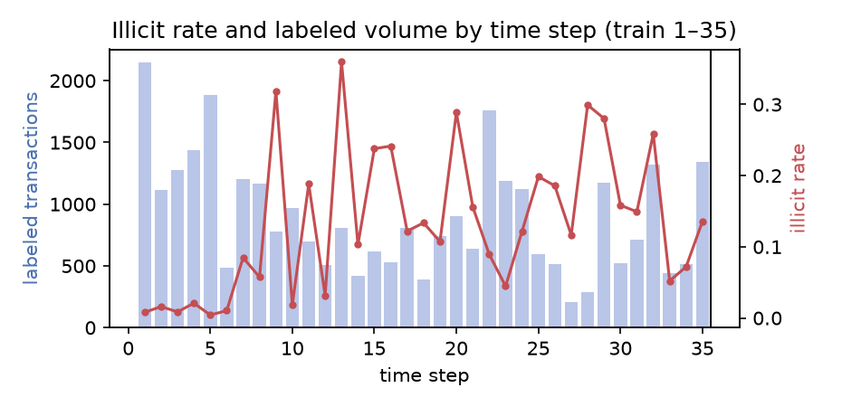
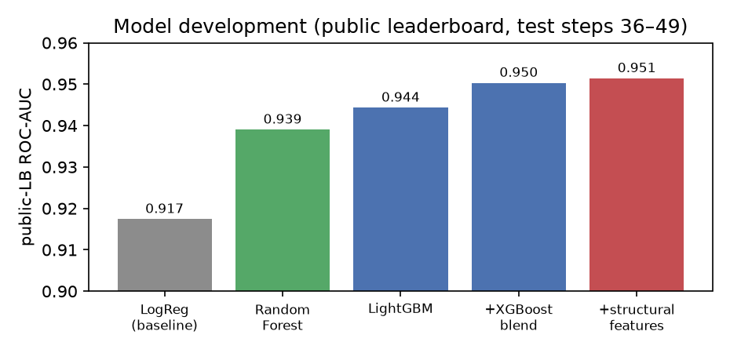

# Fraudulent Bitcoin Transaction Detection

**BT4012 In-class Kaggle Competition — e1408825**
Code & notebook: <https://github.com/USERNAME/bt4012-fraud-detection> *(replace with your repo URL)*

## 1. Introduction

Cryptocurrency payment networks are routinely abused to move illicit funds — money laundering,
scam proceeds, and darknet-market settlements. This competition frames the detection problem on the
**Elliptic** dataset: each Bitcoin transaction is a node described by 165 anonymized features and a
`time_step`, and transactions are linked in a payment-flow graph. The task is to predict, for each
test transaction, the probability that it is **illicit**, scored by **ROC-AUC**. Because AUC depends
only on how transactions are *ranked*, the practical goal is to score illicit transactions above
licit ones — exactly what an anti-money-laundering (AML) triage system needs to prioritize
investigators' attention without a fixed threshold.

Three properties make this hard and shape every decision below: (i) **severe class imbalance** —
only 3,644 of 141,772 training rows are confirmed illicit; (ii) a **mostly-unlabeled pool** —
110,537 training rows have no label; and (iii) **temporal generalization** — the test set is drawn
from strictly later time periods (steps 36–49) than training (1–35), so the model must survive a
real distribution shift. Our high-level approach is a **rank-average blend of gradient-boosted tree
ensembles (LightGBM + XGBoost)** on the raw features augmented with **graph-structure features**,
selected and validated under an honest temporal protocol. The final model reaches **0.9514 public-LB
ROC-AUC**, well above a logistic-regression baseline (0.917).

## 2. Methodology

### 2.1 Data preprocessing and feature engineering

The 165 features are numeric, already standardized, and contain no missing values, so no imputation
or scaling was needed for the tree models. We train only on the **31,235 labeled** rows and treat
the unlabeled majority as **graph structure** rather than discarding it.

A structural fact drove the feature design. We verified that the transaction graph is **partitioned
by time step**: of 234,355 edges, **zero** connect a training node to a test node. Connected
transactions always share a time step. Two consequences follow: (a) labels cannot propagate through
the graph into the future, so semi-supervised graph methods offer no cross-boundary signal; and
(b) any graph feature is inherently a *within-time-step* quantity.

We engineered three feature families:

1. **Raw features (165).** Used as-is.
2. **1-hop graph features.** In/out/total degree and ratios, plus mean/std of local features over
   each node's immediate predecessors and successors. **These added almost nothing** — because the
   dataset's own `feat_94–165` are *already* 1-hop neighbor aggregates, our 1-hop features largely
   duplicated existing signal. This was an important diagnostic.
3. **Beyond-1-hop structural features (35).** To add genuinely new signal we computed: a **32-dim
   structural embedding** via *DeepWalk-as-matrix-factorization* — a sparse truncated SVD of a short
   random-walk co-occurrence matrix (`P + P² + P³`) over the **undirected** graph (undirected
   because the graph is a directed acyclic graph, so directed walks terminate immediately at sinks) —
   plus **PageRank**, **clustering coefficient**, and **2-hop reach**. These capture a node's
   structural *position*, which message-free aggregates cannot, and they use the unlabeled and
   background nodes as connective tissue.

### 2.2 Model development and validation

**Class imbalance** was handled with `scale_pos_weight` (LightGBM/XGBoost) rather than resampling,
keeping the data distribution intact while re-weighting the gradient.

**Validation was temporal, not random.** We trained on labeled steps 1–30 and validated on 31–35 —
the latest labeled steps — to mimic predicting the future; a random split would leak future
information and badly overstate performance. Crucially, we found this holdout to be **saturated**
(~0.99 for every tree model) *and* **anti-correlated with the real test for model ranking**: Random
Forest was the single best model on the holdout yet the *worst* on the leaderboard. We therefore
treated the holdout only as a correctness sanity check and performed **model selection on the Kaggle
public leaderboard** (30% of the test set — genuine future steps), submitting sparingly and guarding
against over-fitting that 30% by keeping a robust model as a fixed final pick.

Predictions from different learners were combined by **rank-averaging**, the natural combiner for an
AUC objective since only ranking matters.

### 2.3 Model exploration and final strategy

We explored a ladder of models (Fig. 2): logistic regression (0.917 — our baseline), Random Forest,
LightGBM, XGBoost, blends, structural features, a Graph Neural Network, and hyperparameter tuning.
The leaderboard progression and key findings:

| Model (public LB) | ROC-AUC |
|---|---|
| Logistic Regression (baseline) | 0.917 |
| Random Forest (raw + graph) | 0.939 |
| LightGBM (raw + graph) | 0.944 |
| LightGBM + XGBoost blend | 0.950 |
| **LightGBM + XGBoost + structural features** | **0.9514** |

- **Boosting beat bagging** on the future steps (reversing the holdout ordering).
- **Learner diversity was the single biggest lever**: adding XGBoost (only ~0.82 rank-correlated
  with LightGBM) lifted the blend ~0.005.
- **Beyond-1-hop structural features** added the final ~0.001; 1-hop features did not.

**Negative results**, confirmed on the leaderboard and reported for honesty: a custom inductive
**GraphSAGE GNN** was individually weaker than the trees (~0.98 holdout) and only ~0.4–0.5
rank-correlated with them — its diversity was *noise*, so blending it in *reduced* AUC (0.951 → 0.949
even at 15% weight). Heavier **regularization** (0.950) and **recency weighting** (within noise) also
failed to beat the defaults. The **final model** is therefore the simpler, stronger
**LightGBM + XGBoost rank-average blend on raw + graph + structural features**.

## 3. Results and Discussion

The final model scores **0.9514** on the public leaderboard, a large margin over the logistic
baseline (0.917) and a realistic ~0.045 drop from the saturated holdout (~0.997) — a direct
measurement of the future-time distribution shift. Fig. 1 shows why that shift is hard: illicit
prevalence swings sharply across time steps, and the test window lies entirely beyond the labeled
period, including the well-known "dark-market shutdown" that destabilizes later-period detection.

**Strengths.** The approach is robust and honestly validated: it leans on model/feature *diversity*
rather than over-fitting a single learner, and model selection used the true future-step signal
instead of a misleading holdout. **Limitations.** Our offline validation could not rank candidates,
forcing reliance on the rate-limited public leaderboard; and the gap to the top of the leaderboard
(~0.96+) suggests additional graph signal we did not capture. The GNN's failure is consistent with
prior Elliptic findings that tree models outperform GNNs here — on a graph that is shallow,
feature-rich, and time-partitioned, message passing adds little the engineered features do not.

## 4. Conclusion and Reflection

We built a fraud detector that generalizes across time by combining gradient-boosted trees with
graph-structure features and selecting it under a temporal, leaderboard-grounded protocol. The
project's main lessons were methodological: (i) **diversity**, not single-model tuning, drove every
real gain; (ii) a validation set can be worse than useless — ours was *anti-correlated* with the
test, so trusting it would have actively hurt; and (iii) **negative results matter** — ruling out the
GNN, regularization, and recency weighting cleanly focused effort on what worked. Future directions
include temporal GNNs designed for distribution shift (e.g. EvolveGCN), motif/subgraph-count
features, and pseudo-labeling within training time steps. The end-to-end pipeline — raw data to
submission — is reproducible from the single notebook `e1408825.ipynb` in the linked repository.
